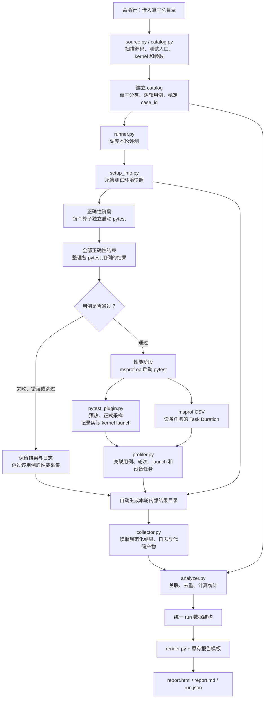
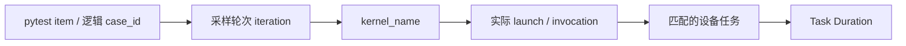

# Triton 算子评测报告：整体流程

本文说明当前 `report` 模块从算子目录输入，到自动执行测试、收集分析和报告输出的完整流程。

## 1. 使用入口

在 `OpentileTest_code_repo/` 根目录运行：

```bash
python -m report run --testcases ./testcases --output ./report/outputs/latest
```

用户提供算子所在的总目录和输出目录。XML、JSON、profiler CSV、日志和环境快照由模块自动生成，无需手动整理。

自动执行需要测试环境已安装 pytest、Torch/Triton、CANN、msprof，并能访问 NPU。模块使用已有工具链，不负责安装或替换编译器。

## 2. 整体流程图



执行顺序是先完成所有算子的正确性阶段，再进行通过用例的性能阶段。一个用例失败不会阻止其他通过用例的性能采集。

## 3. 各模块的输入、处理和输出

| 模块 | 输入 | 主要处理 | 输出 |
|---|---|---|---|
| [__main__.py](../__main__.py) | 命令行参数 | 连接扫描、执行、收集、分析和导出 | 本轮完整报告 |
| [source.py](../source.py) | 算子目录内的 Python 源码 | 逐文件解析 AST，识别 JIT 函数、启动证据及源码位置 | kernel 候选、入口识别依据、源码快照 |
| [catalog.py](../catalog.py) | 源码扫描结果、`operator_catalog.json` | 分类，展开静态参数，生成稳定 `case_id` | 全量算子与逻辑用例清单 |
| [execution.py](../execution.py) | 静态用例、实际 pytest 参数及运行上下文 | 规范化参数，匹配或补充运行时用例 | pytest item 与逻辑用例的关联 |
| [runner.py](../runner.py) | catalog、设备及执行选项 | 启动独立子进程，执行正确性门禁，管理超时和产物目录 | 正确性结果、性能结果、执行记录 |
| [pytest_plugin.py](../pytest_plugin.py) | pytest item、实际函数及 kernel 调用 | 记录测试结论、采样轮次、launch 和可用编译产物 | `inventory.json`、`items.jsonl`、`launches.jsonl` 等 |
| [profiler.py](../profiler.py) | 实际 launch 记录、msprof CSV | 关联设备任务，剔除预热，按轮次汇总 | 规范化性能记录、目标 kernel 设备耗时合计、诊断 |
| [setup_info.py](../setup_info.py) | 执行环境、运行元信息 | 探测软件与硬件信息，区分测试机和报告生成机 | 环境快照、统一评测配置 |
| [collector.py](../collector.py) | 自动生成的内部结果目录 | 读取并校验结果、日志、源码和 CCEIR | 统一收集结果 |
| [analyzer.py](../analyzer.py) | catalog、收集结果、评测配置 | 关联记录，计算覆盖率、正确性和性能统计 | 统一 `run` 对象 |
| [render.py](../render.py) | `run` 对象、报告模板 | 生成数据快照、交互 HTML 和 Markdown | `run.json`、`report.html`、`report.md` |

`profiler.py` 负责原始性能 CSV 的转换；`collector.py` 读取转换后的规范化性能记录；`analyzer.py` 负责报告层面的关联和统计。

## 4. 执行阶段的具体行为

### 4.1 建立全量清单

扫描算子父目录中的实际算子目录，识别各文件顶层 `test*` 函数，并结合参数化和可静态展开的驱动循环生成逻辑用例。分类和特殊参数展开规则保存在 `operator_catalog.json`。

kernel 的原始名称来自源码函数及启动证据，不从算子目录名生成。例如 `_gelu_fwd_kernel` 的报告显示名可以简化为 `gelu`，但底层关联仍使用 `_gelu_fwd_kernel`。静态扫描得到的是入口候选，某个输入实际执行哪些 kernel 还需要运行时记录确认。

pytest 启动后，插件还会收集实际 item 和参数，由 `execution.py` 与静态用例清单关联、补充。无法静态确认完整用例数时，保留已知清单和诊断，报告总用例分母显示 `N/A`。

### 4.2 采集环境并执行正确性

先使用所选测试 Python 采集环境快照，包括 NPU、CANN、驱动、PyTorch、Triton、Python 和操作系统等信息。测试机环境和报告生成机环境分别保存。

每个算子使用独立 pytest 进程，避免不同目录中的同名 `kernel.py` 被模块缓存混用。默认串行执行，并保存实际命令、JUnit XML、逐 item 结果及日志。

若父目录有本仓库格式的 `suite.json`，采用该算子登记的第一种编译配置；`operator_catalog.json` 中的 `execution.env` 可以显式覆盖环境变量。

通过的 pytest item 进入性能阶段，失败、错误、跳过的 item 不进入性能阶段。一个测试函数内部循环多个 shape 时，整体通过可以关联到其静态用例组；整体失败不能确定失败的具体 shape，因此保留未归属失败，跳过该包裹测试的性能采集。

### 4.3 执行性能采集

默认由 `msprof op` 启动新的 pytest 子进程，只保留正确性通过的 item。每个 item 默认完整预热 1 次，再完整采样 3 次。

插件包装标准 Triton 的 `JITFunction.run` 和 `CompiledKernel[grid]` 启动接口。它记录实际启动的函数、所属用例、采样轮次、launch 序号及同步时间窗口；msprof 负责提供设备任务的 `Task Duration`。

时间窗口用于关联任务，不作为设备 latency。插件会在目标 launch 前后同步，因此当前采集会改变原有调度并发关系，适合分析目标 kernel 的设备任务耗时。

### 4.4 关联原始性能数据



有 `Task Start Time` 的 CSV 按同步 launch 窗口关联；没有时间戳的 CSV，只有在同一 kernel 的任务数和实际 launch 数严格一致时，才按自然排序后的采集顺序关联。预热记录参与关联，但不进入最终统计。

无法唯一关联、采集数量不符或轮次缺失时，记录诊断并排除受影响的性能样本。默认 msprof op 采集上限为 5000 个任务，预热也占用该上限；发生截断时不能把不完整数据当成完整性能结果。

## 5. 多 kernel 算子的统计方式

以 `31_prepare_wy_repr_bwd` 为例，一个逻辑输入会触发多个阶段：无 `g` 时为六个阶段，有 `g` 时为九个阶段。某个阶段还可能因为 grid 拆分发生多次 launch，因此阶段数不等于 launch 数。

```text
一个逻辑输入 case_id
├─ 正式采样第 1 轮
│  ├─ kernel A：launch 1、launch 2
│  ├─ kernel B：launch 1
│  └─ 其他实际执行的 kernel
├─ 正式采样第 2 轮
│  └─ 各 kernel 的全部必要 launch
└─ 正式采样第 3 轮
   └─ 各 kernel 的全部必要 launch
```

同一用例、同一轮中的同名 kernel，各次 launch 的设备任务耗时先相加，再对各轮合计取中位数。例如 kernel A 的三轮合计为 `[4, 8, 6] μs`，明细 latency 为 `6 μs`，不会对它的各个必要 launch 直接取中位数。

有运行观测集合时，只要求本用例实际执行的 kernel 提供性能结果。未执行的条件分支不会被当作缺少性能；没有有效观测集合时仍保留静态清单，避免把采集失败误判成分支未执行。

全部已识别目标 kernel 的每轮耗时合计保存在 `operators[].device_totals`，同时保留原始采样和中位数。该值不包含未纳入目标集合的框架操作，不等于算子端到端 latency。

算子分析表的 Task Duration 范围，仍是该算子各输入、各 kernel 明细中位数的最小值至最大值；算子设备合计保存在统一数据中，当前没有新增为分析表列。

## 6. 统一数据与输出目录

`analyzer.py` 将清单、正确性、性能和评测配置合并成统一 `run` 对象：

```text
run
├─ schema_version / status
├─ metadata                   本轮运行元信息
├─ setup                      评测配置、测试环境和报告生成环境
├─ summary                    全局覆盖率、正确性与性能记录数
├─ operators[]
│  ├─ 分类、kernel 清单、逻辑用例清单
│  ├─ summary                 当前算子的统计
│  ├─ details[]               用例 × kernel 的精度、latency 和代码
│  └─ device_totals[]         目标 kernel 的每轮设备耗时合计
├─ execution                  正确性和性能阶段的执行摘要
├─ unmatched_correctness      无法归属到逻辑输入的正确性记录
├─ logs / warnings / policy
└─ raw_directory              自动执行入口保存的本轮原始产物位置
```

覆盖数按逻辑用例去重，多 kernel、多次 launch 和重复采样不增加用例数量。没有正确性结果不会视为通过，没有性能数据不会填成零。底层协议仍保留 `mode` 区分原始记录，页面不展示执行模式列。

默认输出结构：

```text
report/outputs/latest/
├─ report.html                可离线打开的交互报告
├─ report.md                  Markdown 报告
├─ run.json                   完整数据快照
└─ raw/<本轮唯一 run_id>/
   ├─ run_info.json
   ├─ environment.json
   ├─ environment.log
   ├─ catalog.json
   ├─ execution.json
   ├─ case_results.json
   ├─ performance.json
   └─ tasks/<算子标识哈希>/
      ├─ accuracy/
      │  ├─ config.json / invocation.json / process.json
      │  ├─ inventory.json / items.jsonl
      │  └─ junit.xml / process.log
      └─ performance/
         ├─ 配置、用例记录、JUnit XML 和日志
         ├─ launches.jsonl
         ├─ matched_launches.json
         ├─ msprof/           原始 profiler 产物
         └─ artifacts/        可获取的编译代码产物
```

部分文件按实际执行情况产生。DSL 可以回退到 catalog 中保存的源码快照；CCEIR 仅在编译对象提供 `asm.cceir/cce/cce_ir` 时自动保存，缺失时显示“未提供”。

相同输出目录再次运行时，创建新的 raw 子目录，顶层报告更新为本轮结果。已有 `run.json` 可以直接重新渲染：

```bash
python -m report render report/outputs/latest/run.json
```

也可以从本轮 raw 目录重新收集分析，自动使用其中保存的 catalog 快照：

```bash
python -m report generate --input report/outputs/latest/raw/<run_id> --output report/outputs/reimported
```

## 7. 当前验证范围

当前自动执行流程已通过真实 pytest 子进程与模拟 Triton/msprof 产物的集成验证，尚未在实际 Ascend 环境验证全部算子。

通用适配目前面向顶层同步 pytest 测试函数和标准 Triton 启动接口。异步函数、自定义启动对象、单次消耗型 fixture，以及无法唯一关联的动态 shape，需要补充适配。性能阶段的多次函数调用会复用本 item 的 fixtures。

`run` 完整通过返回 0；评测失败、跳过、无数据或性能不完整返回 1；参数、路径等致命错误返回 2。离线 `generate` 成功导出返回 0，评测结论读取 `run.json.status`。
